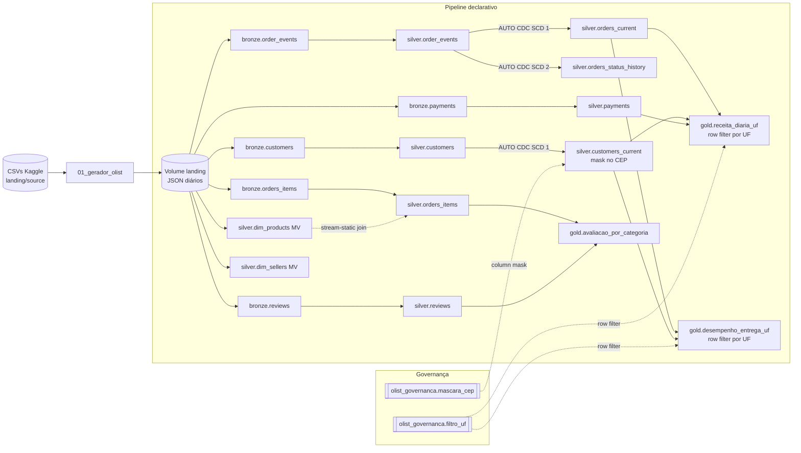

# Databricks Lakeflow Pipeline — Olist

Projeto de estudo de engenharia de dados no **Azure Databricks**, construído para praticar de ponta a ponta os temas do exame **Databricks Certified Data Engineer Associate**: ingestão incremental com Auto Loader, pipelines declarativos (Lakeflow Spark Declarative Pipelines), qualidade de dados com expectations, CDC com SCD tipo 1 e 2, orquestração com Lakeflow Jobs, governança com Unity Catalog (grupos, service principal, GRANTs, row filter e column mask) e versionamento com Git folders.

Os dados vêm do dataset público **Brazilian E-Commerce by Olist** (Kaggle). Um notebook gerador transforma os CSVs originais em arquivos JSON diários, simulando a chegada contínua de dados de um e-commerce.

## Stack

- Azure Databricks (Premium) com Unity Catalog
- Lakeflow Spark Declarative Pipelines (SQL), compute serverless, modo triggered
- Auto Loader (`read_files` em streaming tables)
- `AUTO CDC` (SCD tipo 1 e tipo 2)
- Lakeflow Jobs com trigger de file arrival, If/else, Run if e task values
- Unity Catalog Volumes como landing zone
- Unity Catalog: grupos de conta, service principal, GRANTs com herança, row filter e column mask
- Git folders + GitHub

## Arquitetura



## Estrutura do repositório

```
.
├── 00_setup.py              # cria schemas (olist_raw, olist_bronze, olist_silver, olist_gold) e o Volume de landing
├── 01_gerador_olist.py      # gera N dias de JSON por execução a partir dos CSVs do Kaggle
├── 02_checagem_gold.py      # task do job: publica task values a partir da gold
├── 03_alerta.py             # task do job: alerta genérico (ramo false do If/else e Run if)
├── 04_governanca.py        # schema olist_governanca, GRANTs e funções de row filter e column mask
└── PIPELINE_OLIST/          # código-fonte do pipeline declarativo (SQL)
    ├── ORDERS/
    │   ├── orders_events.sql   # bronze + silver de eventos, CDC SCD 1 e SCD 2
    │   └── orders_items.sql    # bronze + silver de itens, join com dim_products
    ├── PAYMENTS/payments.sql
    ├── REVIEWS/reviews.sql
    ├── CUSTOMERS/customers.sql # bronze + silver de clientes, CDC SCD 1, column mask no CEP
    ├── DIMENSOES/dimensoes.sql # materialized views de produtos e vendedores
    └── GOLD/gold.sql           # materialized views de negócio, row filter por UF
```

## Camadas

### Bronze — `olist_bronze`

Streaming tables com Auto Loader (`STREAM read_files(...)`, formato JSON, schema explícito). Cada linha recebe `_source_file` (de `_metadata.file_path`) e `_ingested_at`. Todas têm `pipelines.reset.allowed = false`, para que um full refresh não apague o histórico ingerido.

| Tabela | Origem no Volume |
|---|---|
| `order_events` | `order_events/` |
| `orders_items` | `order_items/` |
| `payments` | `payments/` |
| `reviews` | `reviews/` |
| `customers` | `customers/` |

### Silver — `olist_silver`

| Tabela | Tipo | O que faz |
|---|---|---|
| `order_events` | Streaming table | Tipagem dos timestamps e expectations |
| `orders_current` | Streaming table (`AUTO CDC`) | Estado atual de cada pedido — SCD tipo 1, com `APPLY AS DELETE WHEN operation = 'DELETE'` |
| `orders_status_history` | Streaming table (`AUTO CDC`) | Histórico de status — SCD tipo 2 com `TRACK HISTORY ON order_status` |
| `orders_items` | Streaming table | Itens tipados (`DECIMAL`) e enriquecidos com a categoria via stream-static join com `dim_products` |
| `payments` | Streaming table | Pagamentos tipados (`DECIMAL`) |
| `reviews` | Streaming table | Avaliações tipadas |
| `customers` | Streaming table | Snapshots de cliente tipados |
| `customers_current` | Streaming table (`AUTO CDC`) | Cadastro atual de clientes — SCD tipo 1. Colunas declaradas explicitamente; `customer_zip_code_prefix` com column mask |
| `dim_products` | Materialized view | Produtos com a categoria traduzida para inglês |
| `dim_sellers` | Materialized view | Vendedores |

### Gold — `olist_gold`

| Materialized view | Conteúdo |
|---|---|
| `receita_diaria_uf` | Pedidos e receita por dia de compra e UF (exclui cancelados e indisponíveis). Com row filter por UF |
| `desempenho_entrega_uf` | Pedidos entregues por UF, prazo médio de entrega e percentual com atraso. Com row filter por UF |
| `avaliacao_por_categoria` | Nota média das avaliações por categoria de produto |

## Qualidade de dados

As expectations cobrem as três ações possíveis:

| Tabela | Regra | Ação |
|---|---|---|
| `order_events` | `order_id IS NOT NULL` | `DROP ROW` |
| `order_events` | `event_ts IS NOT NULL` | `FAIL UPDATE` |
| `order_events` | `order_status` em lista conhecida | `WARN` |
| `order_events` | `operation IN ('UPSERT', 'DELETE')` | `DROP ROW` |
| `orders_items` | `order_id IS NOT NULL`, `price >= 0` | `DROP ROW` |
| `orders_items` | produto encontrado na dimensão | `WARN` |
| `payments` | `order_id IS NOT NULL`, `payment_value >= 0` | `DROP ROW` |
| `reviews` | `order_id IS NOT NULL` | `DROP ROW` |
| `reviews` | `review_score BETWEEN 1 AND 5` | `WARN` |
| `customers` | `customer_id IS NOT NULL`, `snapshot_ts IS NOT NULL` | `DROP ROW` |
| `customers` | UF com 2 caracteres | `WARN` |

Em pipeline triggered, um `FAIL UPDATE` reverte a transação do fluxo que violou a regra. As tabelas downstream não recebem os dados novos daquele update, e os fluxos independentes seguem normalmente. O registro inválido continua na bronze e é relido na execução seguinte.

## Governança (Unity Catalog)

O cenário simulado: analistas consomem só a gold; um analista regional vê só a sua UF; o CEP do cliente é dado pessoal e aparece completo apenas para quem administra os dados.

### Identidades

Todas são identidades **da conta** (não workspace-local), porque só elas recebem GRANT do Unity Catalog e são reconhecidas por `is_account_group_member`. Foram criadas na UI do workspace (*Add group/service principal to account and workspace*).

| Identidade | Tipo | Membros | Papel |
|---|---|---|---|
| `olist_admin` | grupo | administradores dos dados | vê todas as linhas e o CEP completo |
| `olist_analistas` | grupo | `sp_olist`, grupo `olist_analistas_sp` | lê a gold |
| `olist_analistas_sp` | grupo (aninhado em `olist_analistas`) | analistas regionais | vê só UF = SP |
| `sp_olist` | service principal (Databricks managed) | — | identidade de teste dos GRANTs; futura identidade de produção (*Run as*) |

As permissões de workspace (entitlements) seguem o menor privilégio: *Workspace access*, *Databricks SQL access* e *Consumer access*, sem *Admin access* nem criação de cluster.

### Privilégios

Definidos em `04_governanca.py`, concedidos ao grupo e herdados pelos membros:

| Objeto | Privilégio | Efeito |
|---|---|---|
| catálogo `databricksestudos` | `USE CATALOG` | entrada no catálogo, sem acesso a dados |
| schema `olist_gold` | `USE SCHEMA`, `SELECT` | leitura de todas as MVs atuais e futuras da gold, por herança |

Nenhum grupo tem acesso a `olist_raw`, `olist_bronze` ou `olist_silver`.

### Row filter e column mask

As funções ficam num schema próprio, `olist_governanca`, separado das camadas de dados.

| Função | Tipo | Aplicada em | Regra |
|---|---|---|---|
| `filtro_uf(uf STRING)` | row filter | `gold.receita_diaria_uf` e `gold.desempenho_entrega_uf`, coluna `uf` | `olist_admin` → tudo; `olist_analistas_sp` → só `'SP'`; `olist_analistas` → tudo; demais → nada |
| `mascara_cep(cep STRING)` | column mask | `silver.customers_current`, coluna `customer_zip_code_prefix` | `olist_admin` → CEP completo; demais → 2 primeiros dígitos + `***` |

Em tabelas de pipeline não se usa `ALTER TABLE`: o filtro entra no `CREATE OR REFRESH ... WITH ROW FILTER <função> ON (<coluna>)` e a máscara na definição da coluna (`MASK <função>`), o que exige declarar todas as colunas da tabela.

### Testes realizados

| Cenário | Resultado |
|---|---|
| `sp_olist` (job com *Run as*) lê a gold | ✅ |
| `sp_olist` lê `silver.customers_current` | ❌ `INSUFFICIENT_PERMISSIONS` (falta `USE SCHEMA` em `olist_silver`) |
| `receita_diaria_uf` como `olist_admin` | 355 linhas, 27 UFs |
| `receita_diaria_uf` só em `olist_analistas_sp` | 35 linhas, só SP |
| `receita_diaria_uf` sem nenhum grupo (sendo dono da MV) | 0 linhas |
| CEP fora do `olist_admin` | `12942` → `12***`, `02130` → `02***` |
| `REVOKE SELECT ON TABLE` com o `SELECT` concedido no schema | sem efeito: o `sp_olist` continuou lendo |
| `REVOKE SELECT ON SCHEMA` | `sp_olist` perdeu a leitura da gold; voltou com novo `GRANT` |

### Aprendizados

- `is_account_group_member` **considera grupos aninhados**. Por isso o `CASE` do `filtro_uf` testa o grupo mais restrito (`olist_analistas_sp`) antes do mais amplo (`olist_analistas`); na ordem inversa, o analista regional veria todas as UFs.
- Row filter e column mask valem **também para o dono** da tabela. Por isso as funções têm um ramo para `olist_admin`.
- Column mask funciona em tabela alvo de `AUTO CDC` e foi aplicada com refresh normal, sem full refresh.
- Um privilégio só é revogado **no nível em que foi concedido**; o acesso efetivo é a soma de todos os caminhos (catálogo, schema, tabela, grupos, propriedade).
- O papel *Service principal: Manager* não inclui *User*: para usar o SP no *Run as* de um job é preciso o papel *User* explícito.
- Permissões de workspace e do Unity Catalog são independentes: o `sp_olist` tinha `SELECT` na gold, mas só conseguiu rodar o notebook depois que ele foi movido para `Shared`.
- Mudanças de associação a grupos levam alguns minutos para refletir em `is_account_group_member`.

### Decisões

- A bronze também contém o CEP sem máscara. Ela não é mascarada porque nenhum grupo de consumo recebe acesso a ela; fica restrita a engenharia e ao pipeline.
- `avaliacao_por_categoria` não tem UF e fica sem row filter: o analista regional vê as notas de todo o Brasil.

## Orquestração

O job `OLIST_JOB` é disparado por **file arrival** na pasta `landing/order_events/` (a última que o gerador grava), com espera de 60 s após a última alteração. Fila habilitada e notificação por e-mail em caso de falha.

| Task | Tipo | Depende de | Condição |
|---|---|---|---|
| `pipeline_olist` | Pipeline | — | — |
| `checagem_gold` | Notebook `02_checagem_gold` | `pipeline_olist` | Publica os task values `ultima_data` e `pedidos_ultimo_dia` |
| `tem_pedidos` | If/else | `checagem_gold` | `{{tasks.checagem_gold.values.pedidos_ultimo_dia}} > 0` |
| `alerta_sem_pedidos` | Notebook `03_alerta` | `tem_pedidos` (false) | — |
| `alerta_falha` | Notebook `03_alerta` | `pipeline_olist`, `checagem_gold` | Run if: **At least one failed** |

## Como executar

### Pré-requisitos

- Workspace Databricks com Unity Catalog e compute serverless
- Permissão para criar schemas, Volumes e tabelas num catálogo (o código usa `databricksestudos`; troque pelo seu)

### Passo a passo

1. Clone este repositório como **Git folder** no workspace.
2. Rode `00_setup.py` para criar os schemas e o Volume `olist_raw.landing`.
3. Crie na UI os grupos de conta `olist_admin`, `olist_analistas` e `olist_analistas_sp` (aninhado em `olist_analistas`) e o service principal `sp_olist` (membro de `olist_analistas`). Depois rode `04_governanca.py`: as funções precisam existir **antes** do primeiro update do pipeline, que as referencia.
4. Baixe o dataset no [Kaggle](https://www.kaggle.com/datasets/olistbr/brazilian-ecommerce), descompacte e faça upload dos CSVs para `/Volumes/<catalogo>/olist_raw/landing/source/`.
5. Rode `01_gerador_olist.py`. Widgets:

| Widget | Padrão | Uso |
|---|---|---|
| `data_inicial` | `2017-01-01` | Primeiro dia gerado |
| `dias_por_execucao` | `1` | Quantos dias gerar por execução |
| `injetar` | `nenhum` | `warn_drop` ou `fail` para testar as expectations |
| `reiniciar` | `nao` | `sim` apaga os arquivos gerados (exige full refresh do pipeline depois) |

6. Crie o pipeline (*Jobs & Pipelines → Create → ETL pipeline*):

| Configuração | Valor |
|---|---|
| Source code | pasta `PIPELINE_OLIST/` |
| Default catalog | seu catálogo |
| Compute | Serverless |
| Pipeline mode | Triggered |
| Configuration | `landing_path` = `/Volumes/<catalogo>/olist_raw/landing` |

7. Crie o job conforme a tabela de orquestração. Ao rodar o gerador de novo, o trigger dispara o job sozinho.

### Cenários de teste

- **`injetar = warn_drop`**: gera evento sem `order_id`, item com preço negativo, avaliação com nota 7 e um pedido de teste que é criado e depois deletado. Confira a aba *Data quality* e o fechamento do registro em `orders_status_history`.
- **`injetar = fail`**: gera evento com `event_ts` nulo. O pipeline falha, `alerta_falha` executa e o job pode ser corrigido com **Repair run**.

### Custos

Use sempre pipeline triggered (nunca contínuo) e pause o trigger do job quando não estiver usando.

## Limitações conhecidas

- A checagem da gold sempre encontra pedidos no último dia presente na tabela, então o ramo false do If/else (`alerta_sem_pedidos`) não é exercitado na prática.
- `avaliacao_por_categoria` calcula a média após o join com os itens, então pedidos com mais itens de uma categoria pesam mais na nota média.
- `receita_diaria_uf` usa a UF atual do cliente (SCD tipo 1), não a UF da época da compra.
- `dim_sellers` ainda não é usada na gold.
- As materialized views de dimensão leem arquivos direto do Volume, o que impede refresh incremental. Como são pequenas e estáticas, o recompute completo é aceitável.
- A definição do job e as configurações do pipeline ainda não estão versionadas neste repositório.
- O catálogo `databricksestudos` está fixo nos nomes das funções de governança (`gold.sql`, `customers.sql`) e em `04_governanca.py`. Um ambiente dev com outro catálogo vai exigir parametrizar esses nomes.
- Um grupo por UF não escala (27 grupos e 27 ramos no `CASE`). A evolução natural é uma tabela de mapeamento grupo → UFs consultada pela função, ou políticas ABAC com tags governadas.

## Próximos passos

- Empacotar pipeline e job em Declarative Automation Bundles (`databricks.yml`) com targets dev e prod.
- Governança: comparar o row filter com uma dynamic view e com uma política ABAC (tag `pii` no CEP).
- Análise de desempenho no Spark UI e no query profile.

## Dados e licença

O dataset **Brazilian E-Commerce Public Dataset by Olist** não está incluído neste repositório. Baixe-o diretamente no [Kaggle](https://www.kaggle.com/datasets/olistbr/brazilian-ecommerce) e respeite a licença indicada na página do dataset.
